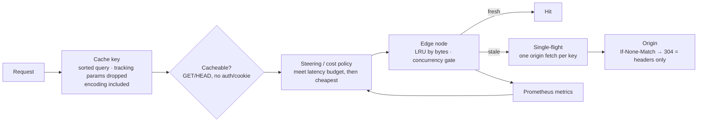

# Edge Cache & Traffic Routing

**The building blocks of a CDN edge in Rust: a byte-bounded LRU cache with honest hit-ratio accounting, ETag revalidation, request coalescing against cache stampedes, latency- and load-aware node steering, and a cost policy that picks the cheapest node that still meets a latency budget.**

Every request to a content network raises one question: which node should serve these bytes? The fastest node isn't always the cheapest, a popular object expiring can flatten an origin, and a cache dashboard can make a bad cache look good. This project implements each piece of that decision with the reasoning in the code, plus the metrics, alerts, and experiment needed to judge it by numbers rather than intuition.



## What's implemented

- **Cache keys that are correct first.** Query parameters are sorted, `utm_*`/`fbclid`/`gclid` are dropped, and the negotiated encoding (`br`, `gzip`, `identity`) is part of the key. Requests with `Authorization` or `Cookie` headers bypass the cache entirely.
- **LRU bounded by real memory.** Capacity counts body, ETag, and entry overhead, not just bodies; objects larger than the whole cache are refused rather than evicting everything.
- **Honest hit ratio.** A stale entry is counted as a miss, and revalidations are a separate outcome rather than being folded into hits.
- **Revalidation without refetching.** Stale entries are revalidated with `If-None-Match`; a `304` refreshes the expiry and transfers zero body bytes. `Cache-Control` `max-age`, `no-store`, and `no-cache` are honored, with a conservative 60-second default.
- **Stampede protection.** A single-flight layer ensures one origin fetch per key; concurrent requesters subscribe to the leader's result, with the subscription taken under the lock to avoid the classic lost-wakeup race. A stale-while-revalidate helper lets requests be served immediately while refreshing out of band.
- **Load-aware steering.** Nodes are scored by EWMA latency multiplied by a load penalty of 1 / (1 − load), nodes at ≥ 90% load are shed, and when every node is shed the least-loaded one serves rather than returning a 503.
- **Cost under a latency budget.** Expected per-request cost includes egress plus origin pulls on misses, so a low-hit-ratio node costs more even at the same advertised price. The policy picks the cheapest healthy node within budget and falls back to the fastest if none qualify.
- **Measurable by design.** Per-node Prometheus metrics (hits, misses, revalidations, evictions, origin bytes, EWMA latency, load, cost) labeled only by node and region — never by cache key. `alerts.yml` defines hit-ratio collapse, origin bandwidth spikes, and node saturation alerts.
- **Realistic load.** An open-loop generator issues Zipf-skewed requests on a fixed schedule, so a slowing system can't quietly reduce its own load.

## The experiment

[EXPERIMENT.md](EXPERIMENT.md) defines a three-node test: raise one node's price mid-run and watch traffic move, then relax the latency budget and measure what the cheaper, slower node costs users. Running the cost policy on that setup (budget 60 ms; nodes `a` 20 ms / 8¢, `b` 25 ms / 3¢, `c` 90 ms / 2¢ per GB) chooses:

| Run | Change | Chosen node |
|---|---|---|
| 1 | Baseline | `b` — within budget and cheaper than `a`; `c` excluded by latency |
| 2 | `b` raised to 12¢/GB | `a` |
| 3 | Budget relaxed to 120 ms | `c` |

These are policy decisions from a unit check, not load-test measurements; the full timed runs with hit ratio, p95, and origin bytes haven't been recorded in the repo.

## Building

The repository contains the modules but not the crate scaffolding. To build, add a `Cargo.toml` and a `src/lib.rs` declaring the eight modules:

```toml
[dependencies]
tokio = { version = "1", features = ["full"] }
rand = "0.8"
reqwest = { version = "0.12", default-features = false, features = ["rustls-tls"] }
```

```rust
// src/lib.rs
pub mod cache; pub mod coalesce; pub mod cost_policy; pub mod edge;
pub mod loadgen; pub mod metrics; pub mod origin; pub mod steering;
```

With that, the code compiles on stable Rust (verified with the versions above).

## Layout

| File | Purpose |
|---|---|
| `src/edge.rs` | Cache-key normalization, cacheability, concurrency gate |
| `src/cache.rs` | Byte-bounded LRU and hit-ratio stats |
| `src/origin.rs` | `Cache-Control` parsing and ETag revalidation |
| `src/coalesce.rs` | Single-flight fetches and stale-while-revalidate |
| `src/steering.rs` | Node health, EWMA latency, load-penalized selection |
| `src/cost_policy.rs` | Latency-budgeted cost minimization |
| `src/metrics.rs` | Prometheus text exposition |
| `src/loadgen.rs` | Zipf keys and open-loop request driver |
| `alerts.yml` | Prometheus alert rules |
